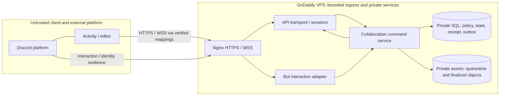
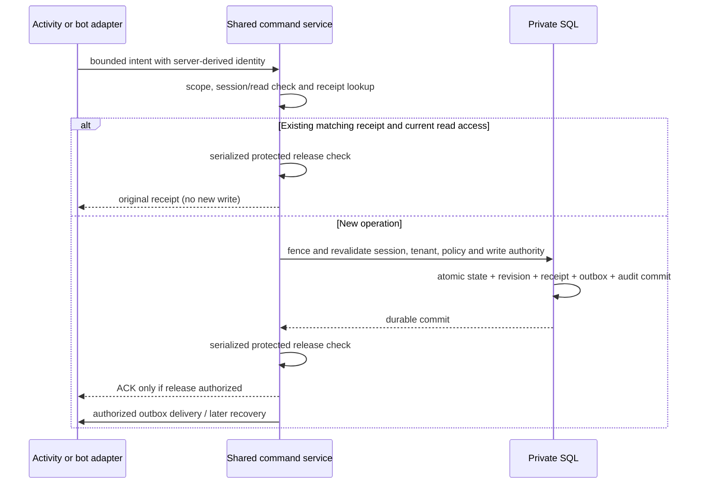

# Architecture boundaries and initial constraints

The owner accepted the controlled experiment and VPS direction in [ADR 0001](adr/0001-editor-activity-vps-direction.md). The system specification and downstream research and verification gates remain open; this is not a certified running architecture.

| Boundary | Responsibility | Trust rule |
| --- | --- | --- |
| Activity frontend | Discord SDK lifecycle, React shell, Excalidraw adapter | Client role and guild claims are untrusted |
| API | OAuth exchange, sessions, tenant-scoped routes | Resolve identity and policy on server |
| Bot | Guild installation and authorized slash commands | Verify interaction and guild context |
| Collaboration | Authorized operation processing, presence, recovery | Server sequences accepted intent; no full-document last-write-wins |
| MySQL/MariaDB | Board metadata, policy, operations, snapshots, audit | Commit operation and receipt atomically before acknowledgment |
| Asset store | Opaque, scoped validated uploads | No user-controlled filesystem paths |
| GoDaddy VPS | Nginx HTTPS/WSS, private services, durable volumes | Real external networking tests required |

Policy must be evaluated against current role/grant/mode generation for every mutation, including already-connected clients. A grant revoke must fence in-flight writes. Tenant keys must scope every lookup, cache entry, room, operation ID and asset reference.

Concurrency decisions must explicitly cover same-object edits, undo intent, compound operations, idempotency, durable revisions and snapshot boundaries. Feature implementations wait for reviewed contracts rather than choosing incompatible synchronization strategies independently.

No specific capacity, latency, RPO/RTO or availability claim is established. Research will define objectives; verification will measure achieved results. No production hostname, credentials or VPS instance has been provisioned by this bootstrap.

## Interaction architecture (GB-T0.01.02.T1)

This is a proposed interaction view of the [accepted GB-T0.S1 boundary contract](specifications/GB-T0-S1-system-contract.md) and [ADR 0001](adr/0001-editor-activity-vps-direction.md); it does not supersede their wire defaults, receipt ordering or accepted direction. The contract file retains its original proposal-era status text; the later acceptance is recorded in [T0](workstreams/T0.md). [ADR 0002](adr/0002-server-authority-and-interactions.md) records the section decision and awaits fresh review and coordinator acceptance. [Interaction scenarios](specifications/fixtures/GB-T0-01-02-interactions.json) are declarative review evidence, not product tests.

The external ingress, proxy-to-service hop and private data plane are separate trust boundaries. The diagram is logical: exact Discord routing, cookies, proxy trust and transport setup require real-platform verification. Only explicitly trusted proxy hops supply forwarding information. Public clients cannot directly reach SQL or assets. All inputs are bounded; errors must be safe and versioned as specified in GB-T0.S1.

| Boundary | Transport and ownership | Authority and storage |
| --- | --- | --- |
| Activity / T1, T3, T7 | Discord SDK lifecycle and HTTPS/WSS client; editor presents tentative and accepted state | Client claims, role flags and selectors are untrusted; no secrets or database access |
| API / T1, T8 | OAuth/session adapter, bounded HTTP and WSS; join/rejoin and safe error mapping | Server derives identity and tenant from verified session evidence; selectors are scoped, never authority |
| Bot / T1, T2, T8 | Verify interaction and context, then translate authorized moderation intent to the same command service | No direct database mutation or separate policy bypass; actual Discord verification and source remain runtime work |
| Collaboration / T2, T4, T6 | Shared command service checks current policy, serializes write and protected releases; outbox drives live delivery, replay or snapshot recovery | Server sequences accepted intent; presence is lossy and separate from durable events |
| Data and assets / T5 | Private SQL transactions, private quarantine and finalized asset storage through server interfaces | Scoped policy, state, revision, receipt, outbox and audit are durable together where required; opaque asset references never give direct public access |
| Platform / T10–T11 | Nginx TLS/WSS and private service hops on GoDaddy Linux VPS; persistent storage | Trust configuration, secrets, backups and deployment are verified separately |

### Authentication, join and protected reads

1. The Activity initiates the T1 OAuth/session flow. The server verifies the available identity and guild/channel evidence and establishes a session; no client-supplied identity or tenant claim grants access. T1/T2 must establish the actual Discord evidence source, scopes, freshness, role invalidation, cookies and proxy behavior before privileged use.
2. HTTP or WSS join selects a board under the verified tenant. An unknown or foreign board has the same public `NOT_FOUND` outcome. An expired or revoked session is denied; unavailable or stale trusted membership, policy or time fails closed. A viewer with read access may join but cannot write.
3. On join or reconnect, the server reauthorizes and chooses bounded ordered replay or a consistent snapshot and tail per GB-T0.S1. Live events, replay, snapshot metadata and each queued chunk, assets, receipts and ACKs pass the same serialized release fence against current session, membership and scoped read authority. Revocation ordered first suppresses subsequent queued releases; already emitted bytes cannot be recalled. Interrupted snapshots are not promoted. No protected data, receipt existence or digest result leaks on denial.

### Writes, moderation and recovery

The bot's verified moderation interaction enters that same path, including tenant, policy and transaction fences; a forged context, wrong tenant, viewer privilege or expired session cannot mutate through HTTP, WSS or bot. A read revoke suppresses protected responses on all three paths; an allowed write committed before revocation remains committed even when its ACK is suppressed. The applicable safe denial is determined by the canonical contract, including indistinguishable foreign and unknown resources.

If a prior identical receipt exists, current read access permits its return even after write permission is lost; this is not permission to write. After restore, a retained historical receipt settles only the original lineage's acceptance: never replay the operation into the restored document or mark that document saved from it. Rejoin and validate current lineage state. If no receipt exists for an old lineage, reject the old intent as specified; a digest conflict is also protected by the release fence.

Invalid configuration prevents startup or the affected capability without exposing secrets. Missing trusted prerequisites fail closed. A precommit failure rolls back without a committed revision, receipt or accepted event. A timeout or interruption after a possible commit is an unknown outcome: retain the original identity and preconditions for a safe retry, never show a false saved state or claim rollback. A denied release cannot settle that uncertainty. T7 owns the corresponding pending, rejected and reconnecting states.

### Upload handoff and downstream work

Uploads enter private quarantine with bounded size and scoped ownership. T5/T9 must define validation, scanning, cleanup and atomic finalization with the board reference before an opaque object is usable. An interrupted or rejected transfer is not a finalized asset and must not appear saved; asset metadata and every queued delivery chunk use the same read fence. Exact storage protocols and crash recovery are downstream contracts.

T1/T2 verify Discord identity, role freshness and policy; T3/T4 define editor mapping, synchronization and recovery; T5 supplies durable SQL, assets and restore lineage; T6/T7 supply mode policy and honest UI states; T8 supplies strict transports and bot mapping; T9 independently reviews abuse, security and retention; T10/T11 verify GoDaddy TLS/WSS, proxy, storage and operations; T12/T13 convert scenarios to integrated tests and release evidence. [Requirements](requirements/GB-T0-01-01-requirements.md) and the [MVP matrix](../planning/MVP-ACCEPTANCE.md) remain the scope and verification trace. No Discord, browser, database crash, VPS, licensing, security release or production result is claimed here.
